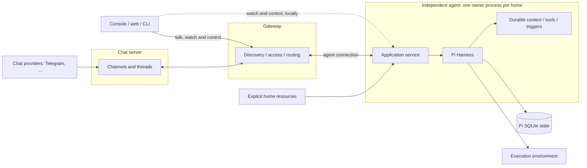

# 🦐 The three programs and what each owns

This is one piece of the design. The words for a decision's status, such as Confirmed or Open, are explained in the [plan](../PLAN.md#the-design).

An agent owns one home and its private work, the chat server owns the shared record of what was said, and the gateway owns who is on the network and how to reach them. They share only contracts.

**The design**

The host builds the model and credential runtime, the trusted durable registry, the environment resolver, SQLite storage and the service, then supervises them. Opening a home's storage changes it, because durable resets unfinished work on every open. The phase 0 spike saw a second process that only opened a live home flip the owner's running turn back to pending, and a second owner send a model request twice and corrupt the first owner's session. So only the owner ever opens a home's storage, and commands that read a home's sessions go through the owner's API. The owner takes an exclusive lock on the home before anything that writes or serves, meaning opening storage, starting servers or binding sockets, and holds it for its lifetime. Reading the home's files comes first, so a home that doesn't load or names an unusable model fails without claiming it. The spike's 21-line lock on `node:sqlite` works on macOS, and its tests passed on Linux on 2026-10-07. It is held for as long as something holds what taking it returned.

Pi owns submissions, `InboxDoc`, `LiveDoc`, `UsageDoc`, conversation entries and configuration, generation, tool and compaction tasks, checkpoints, child ownership and structural watches. Shrimpy reads them directly. Query indexes and UI caches are disposable and name their source.

Shrimpy's own documents hold only what Pi lacks: the thread each session belongs to; immutable source and target provenance; context-source evidence; chat and trigger receipts and policy; where the agent stands in chat's feed; and an ID for the records themselves. A reply waiting to be posted isn't among them: the task that follows its event holds it. Thread names and archive state live with the threads on the chat server. They are written through Harness commits. Pi's statuses are never copied into them.

The host gives each session an `ExecutionEnv`. Replayable operations need a stable resource and cwd identity. Extension code is trusted host code and can bypass the environment, and process cleanup is a separate guarantee from containment.

- **Unsafe by default.** Every built-in durable tool is unsafe; writes, edits, shell commands and unqualified sends stay that way. A custom `safe` declaration needs a stable target and proven deduplication by task or call ID. Deduplicating accepted sends still isn't exactly-once delivery, so uncertain results stay visible.
- **Ownership.** Foreground ownership controls joins and abort; background ownership is explicit. A client disconnect, navigation or cancelled wait never aborts accepted work. Abort reports done only after cancellation settles. Controls never hold a transaction while waiting on their own running turn.
- **Supervision.** Shutdown is bounded and accounts for tool descendants. Cooperative abort kills owned process groups, but killing the owner can leave detached processes running. Prove cleanup with a delayed-write child under the chosen supervisor before advertising it. If that can't be guaranteed, show possible continuing effects and flag the limit for review.
- **Storage.** SQLite in WAL/NORMAL mode survives process crashes, not power loss. Back up from stopped snapshots that include the WAL. Pin Pi's package and task contracts. Before opening admission, the host checks extensions and pending task definitions and names affected sessions on failure, because Pi alone may drop a missing extension or block single tasks. The host installs Shrimpy's extensions after it opens storage and before it resumes work, since what posts to chat is made from the ID of the records. Pi advises installing before the open so recovered work can resume at once; here nothing runs until the host resumes, and this check runs after the install. Durable brings its own tables and documents up to date whenever it opens storage, and refuses what a newer release wrote. Waiting work is stored too: what Pi keeps for a waiting task, such as a wake-up set for next week, is written in the shape of the release that made it, and Pi won't hand an old shape to new code that doesn't say how to read it. So a release that changes a task's shape gives it Durable's `migrate`, or Durable blocks the waiting task and the turn it belongs to ends unanswered. Most releases won't change it.
- Pin every Pi package Shrimpy uses at exactly one release, 1.5.2 since the move decided on 2026-11-14, as one set: an upgrade changes them together, and stops if any package's license isn't MIT, which every one is today. Use public exports only.

The gateway handles discovery, access and routing between clients, agents and the chat server, as Chord's relay that every program connects out to, which [the network](6-network.md) describes. It keeps the roster, with each member's name and ways in, and the workspace context. It never holds agent homes, Pi storage, execution or conversations, and it reaches agents' sessions only through their API. Losing the gateway pauses chat and remote access but never stops an agent. Watching and controlling an agent on its own machine works without a gateway; talking needs the gateway and the chat server, and on a single machine both run locally.

**Decisions**

| Topic | Today | Proposed | Decision |
|---|---|---|---|
| Stopping and cancelling | — | Service stop halts execution and keeps records; restart follows the [recovery](4-conversation.md) rules. Cancelling work is a separate action, scoped to one session or the whole home, and the three controls are labelled so they can't be confused. Shutdown stops taking new work, gives running turns a short timeout to finish, then pauses the rest; `--now` skips the wait. | Confirmed |
| `shrimpy up` and what it started | — | It keeps the Shrimpy folder running: it starts the agent of a home that appears, and stops the agent of a home that is taken away. Whatever it started that ends by itself, an agent, the gateway or the chat server, is reported and started again alone, after a pause that grows from 2 seconds to 5 minutes while it keeps failing and starts over once it has stayed up for a minute. A home whose agent can't start is said once and tried again, and stops nothing else. With agents named it runs only those, the same way. Closing the terminal leaves the programs running. | Changed on 2026-10-07, when an agent was first started again alone after you asked that adding an agent take nobody starting anything. Confirmed on 2026-11-14, with the gateway and the chat server started again alone too, and one behavior with agents named or not: "this ux has to be simple for users". Until then, `up` stopped everything when the gateway or the chat server ended, and with agents named when anything did. Programs started on their own, with `agent serve`, `gateway serve` and `chat serve`, don't share a fate: losing the gateway never stops such an agent. |
| A copied home | — | A home copied with its token was the same agent twice: two live connections with one member, and nothing chose between them. | Changed, and built on 2026-10-04. An agent has one live body. While it runs, the gateway turns away a program that joins with its token, signs in with it under another name or registers as it, and renames nothing. The gateway says what happened; the agent, which knows its home, says how to make a copy an agent of its own, once, while it keeps trying. A copy takes the agent's place once the first one stops, since a copied token is the same agent. |
| Stored data across updates | Each store refuses another version, and says to move it aside and start over | From 1.0.0 the program that owns a store migrates it forward when a release that changes its format first starts, after copying it aside, and keeps the copy until the next migration. That covers the chat store, the roster, and Shrimpy's documents and tasks in each agent's storage. An agent also copies its storage before new Pi packages open it, since Durable brings its part up to date on open. A store from this major or the one before migrates, and an older one is refused with words saying nothing migrates it. Going back means putting the copy back: a store refuses what a newer release wrote, with words naming the copy, and nothing migrates down. The home's files are never migrated by code, and old Shrimpy's data stays out. The copy sits beside the store, named for the release that migrated it, such as `chat.before-1.1.0.sqlite`, and a copy of SQLite is one file. Putting it back is moving the store into an archive folder, renaming the copy to the store's name, and running a release from before that one. The chat store keeps its version in SQLite's `user_version` and its steps as SQL, since Chord's runner counts from 1 in a table of its own. An agent's storage keeps its version in a table of its own, `shrimpy_storage`, and goes up a version with a change to the Pi packages or to the version of one of Shrimpy's documents or tasks. Each version is written down with what it holds, and an agent that installs anything else stops at its start. Storage from before the table is at version 1, the format 1.0.0 ships. | Confirmed on 2026-11-23: "agree", and "yes" for nothing migrating down. The copy's place, the chat store's `user_version` and the agent's table the same day: "Go ahead". Built that day, except the fixtures below |
| Node | The Node that runs the command, whichever installed it. The service names its path, which a `brew upgrade` can remove | An installed Shrimpy runs on a Node of its own, from nodejs.org and checked against Node's checksums: one exact version for each release, named in `.node-version`, and Node 26 for 1.0.0, since Node 22 ends in April 2027 and Ubuntu 24.04's own is 18. The service, the `shrimpy` command and each agent's shell name it by its path beside Shrimpy's code, which only Shrimpy changes, as installing in [using it](using-it.md) has it. The checks run on it, and a Node security release means a Shrimpy patch release. Shrimpy installs only where Node has official builds: macOS, and Linux with glibc, on arm64 or x64. | Confirmed on 2026-11-23: "lgtm" |

**Open**

What the runs on Linux showed, and what is still to try there, is in [status](../STATUS.md).

**Not built yet**

- `.node-version`, naming Node 26, and the checks running on it, as the row on Node says.
- `shrimpy up` starting the gateway and the chat server again alone, and behaving the same with agents named, as the row on it says.
- A fixture of each store at each release from 1.0.0, and a test that opens every fixture of this major and the last, as the row on stored data says.
